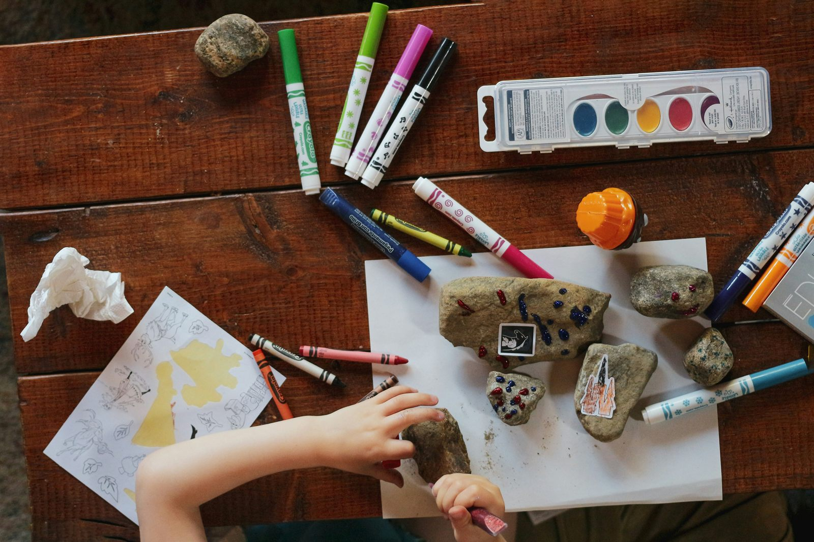
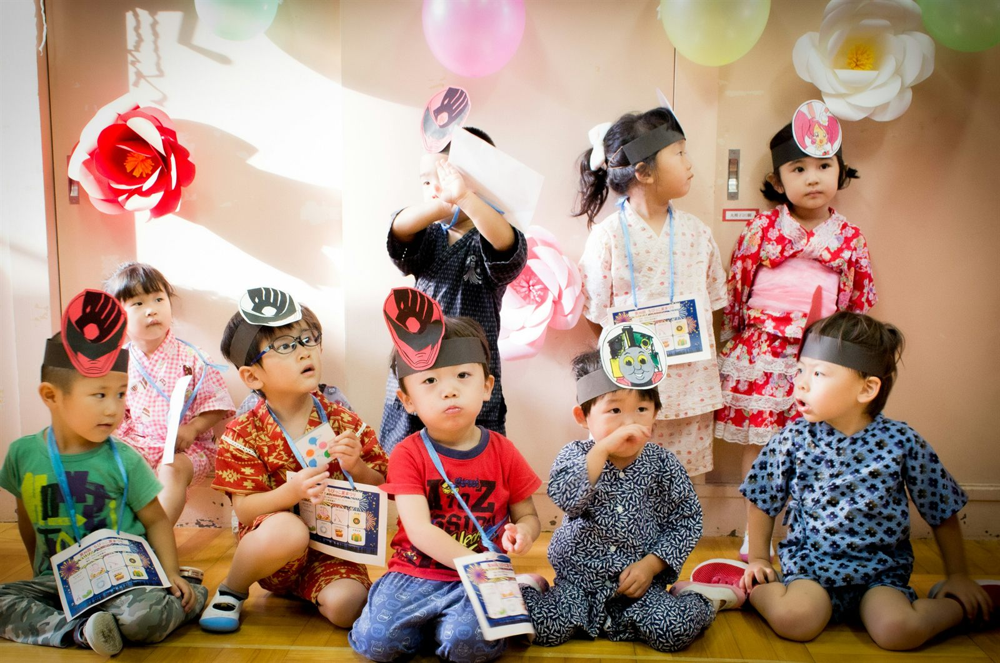
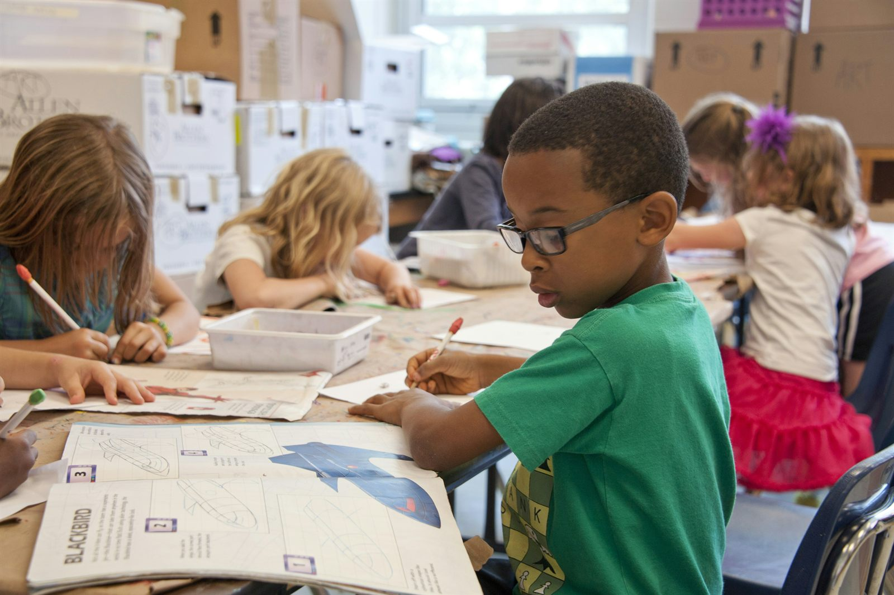

  <h1>A peek into our days</h1>
  
Every day at ShiningStars is filled with play, discovery, and connection. Here are a few moments from our classrooms and outdoor spaces.

  <figure class="gallery-item">
    
    <figcaption>Teamwork and friendship</figcaption>
  </figure>
  <figure class="gallery-item">
    
    <figcaption>Small groups, big discoveries</figcaption>
  </figure>
  <figure class="gallery-item">
    
    <figcaption>A bright, welcoming classroom</figcaption>
  </figure>
  <figure class="gallery-item">
    
    <figcaption>Learning through play</figcaption>
  </figure>
  <figure class="gallery-item">
    
    <figcaption>Storytime every day</figcaption>
  </figure>
  <figure class="gallery-item">
    
    <figcaption>Our infant room</figcaption>
  </figure>
  <figure class="gallery-item">
    
    <figcaption>Toddler adventures</figcaption>
  </figure>
  <figure class="gallery-item">
    
    <figcaption>Ready for pre-K</figcaption>
  </figure>

<section class="cta-banner">
  <h2>Come see it for yourself</h2>
  
Book a visit to meet our educators, explore the classrooms, and see how your child could fit right in.

  

    <a href="/contact/" class="btn-primary">Schedule a Visit</a>
  

</section>
