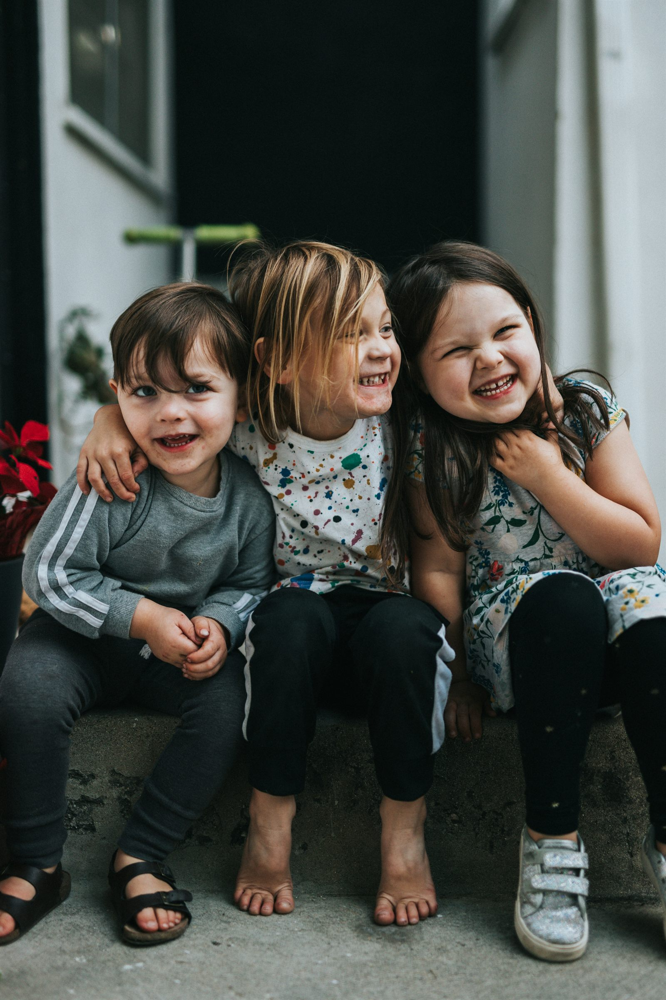
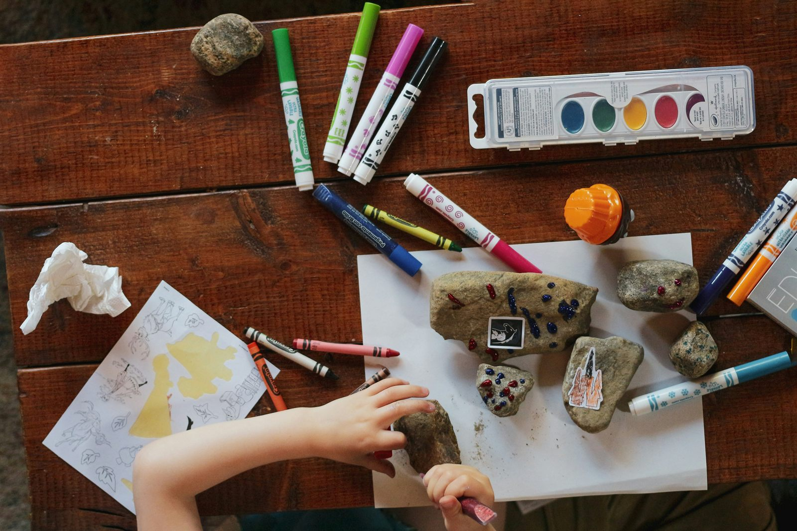
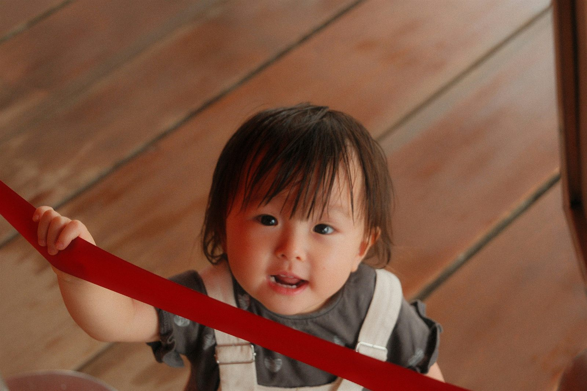
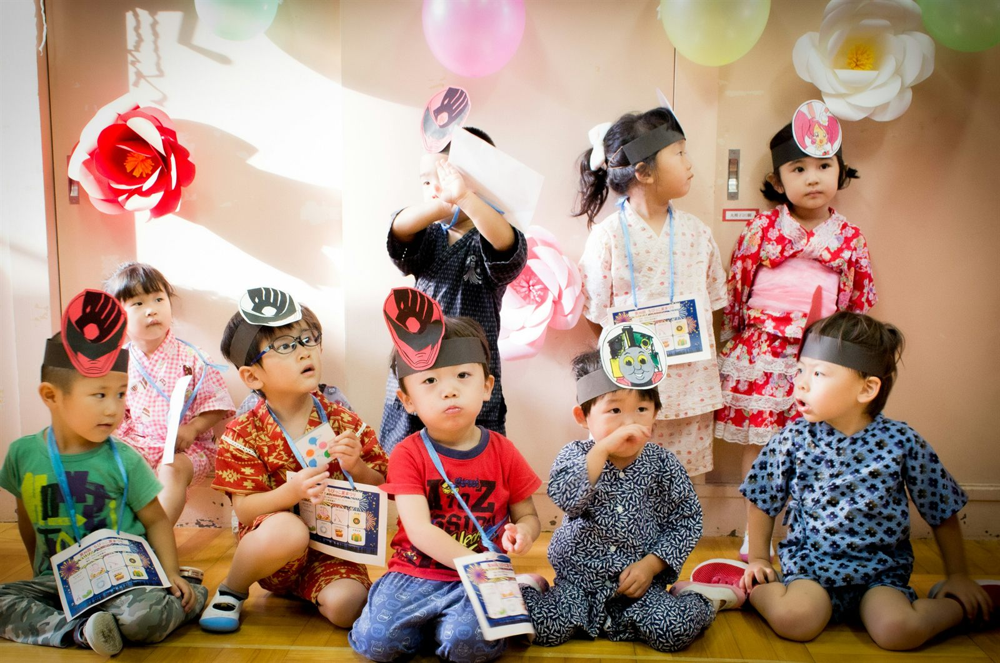
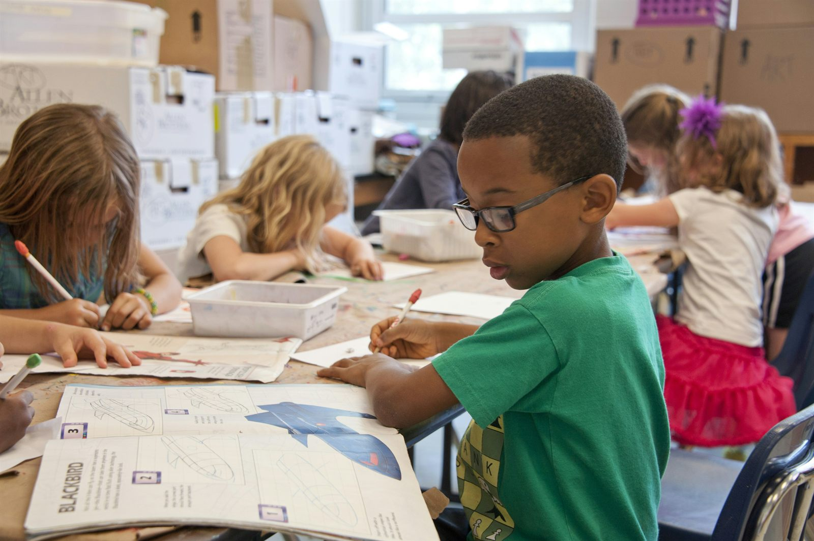

  <h1>Un aperçu de notre quotidien</h1>
  
Chaque journée à ShiningStars est remplie de jeu, de découvertes et de rencontres. Voici quelques moments captés dans nos classes et nos espaces extérieurs.

  <figure class="gallery-item">
    
    <figcaption>Esprit d'équipe et amitié</figcaption>
  </figure>
  <figure class="gallery-item">
    
    <figcaption>Petits groupes, grandes découvertes</figcaption>
  </figure>
  <figure class="gallery-item">
    
    <figcaption>Une classe lumineuse et accueillante</figcaption>
  </figure>
  <figure class="gallery-item">
    
    <figcaption>Apprendre par le jeu</figcaption>
  </figure>
  <figure class="gallery-item">
    
    <figcaption>L'heure du conte, chaque jour</figcaption>
  </figure>
  <figure class="gallery-item">
    
    <figcaption>Notre pouponnière</figcaption>
  </figure>
  <figure class="gallery-item">
    
    <figcaption>Les aventures des bambins</figcaption>
  </figure>
  <figure class="gallery-item">
    
    <figcaption>Prêts pour la prématernelle</figcaption>
  </figure>

<section class="cta-banner">
  <h2>Venez voir de vos propres yeux</h2>
  
Réservez une visite pour rencontrer nos éducateurs, explorer les classes et découvrir comment votre enfant pourrait s'y épanouir.

  

    <a href="/fr/contact/" class="btn-primary">Planifier une visite</a>
  

</section>
