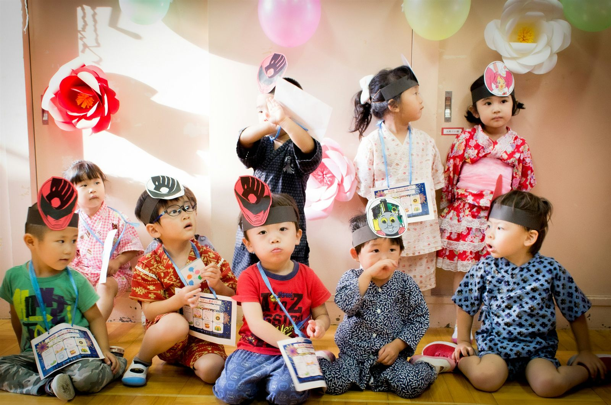
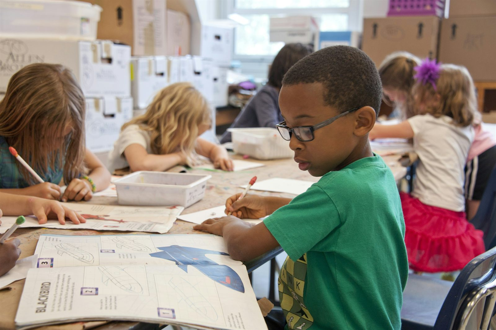

  <h1>Nos programmes</h1>
  
Chez ShiningStars, nous suivons un programme axé sur le jeu et centré sur l'enfant qui nourrit la curiosité, la créativité et un amour de l'apprentissage tout au long de la vie, à chaque étape du développement.

  <a href="#infant-care" class="btn-primary" style="padding: 0.75rem 2rem; border-radius: 9999px;">Explorer le programme</a>

  

    
  

  

    6 semaines – 18 mois
    <h2>Pouponnière</h2>
    
Notre programme de pouponnière met l'accent sur l'établissement de liens d'attachement sécurisants grâce à des soins attentionnés et à des environnements riches en expériences sensorielles. Nous assurons une transition en douceur entre la maison et le service de garde.

    

Étapes clés d'apprentissage :

    <ul class="learning-list">
      <li><i data-lucide="check-circle-2"></i> Exploration sensorielle</li>
      <li><i data-lucide="check-circle-2"></i> Liens affectifs</li>
      <li><i data-lucide="check-circle-2"></i> Motricité précoce</li>
      <li><i data-lucide="check-circle-2"></i> Éveil au langage</li>
    </ul>
  

  

    
  

  

    18 mois – 3 ans
    <h2>Programme des bambins</h2>
    
Un apprentissage actif pour les petits corps en mouvement ! Notre programme encourage l'autonomie et les interactions sociales par la découverte guidée et le jeu physique.

    

Étapes clés d'apprentissage :

    <ul class="learning-list">
      <li><i data-lucide="check-circle-2"></i> Jeu coopératif</li>
      <li><i data-lucide="check-circle-2"></i> Régulation émotionnelle</li>
      <li><i data-lucide="check-circle-2"></i> Développement du vocabulaire</li>
      <li><i data-lucide="check-circle-2"></i> Motricité globale</li>
    </ul>
  

  

    
  

  

    3 – 5 ans
    <h2>Prématernelle</h2>
    
Préparation aux grandes étapes à venir. Notre programme de prématernelle allie des bases scolaires à l'exploration créative et à la résolution de problèmes.

    

Étapes clés d'apprentissage :

    <ul class="learning-list">
      <li><i data-lucide="check-circle-2"></i> Littératie précoce et mathématiques</li>
      <li><i data-lucide="check-circle-2"></i> Collaboration sur des projets</li>
      <li><i data-lucide="check-circle-2"></i> Démarche scientifique</li>
      <li><i data-lucide="check-circle-2"></i> Expression créative</li>
    </ul>
  

  <h2>Programmes d'enrichissement</h2>
  
Au-delà des bases, nous offrons diverses activités qui éveillent des intérêts particuliers et aident les enfants à découvrir leurs talents uniques.

  
  

    

      
<i data-lucide="music" style="width: 24px; height: 24px;"></i>

      <h4>Musique et rythme</h4>
      
Exploration des instruments, du tempo et de la mélodie par le jeu interactif.

    

    

      
<i data-lucide="globe" style="width: 24px; height: 24px;"></i>

      <h4>Immersion en espagnol</h4>
      
Acquisition naturelle de la langue par le chant et la conversation quotidienne.

    

    

      
<i data-lucide="palette" style="width: 24px; height: 24px;"></i>

      <h4>Studio artistique</h4>
      
Projets d'arts multimédias qui encouragent l'expression créative et l'expérimentation.

    

    

      
<i data-lucide="flask-conical" style="width: 24px; height: 24px;"></i>

      <h4>Petits STIM</h4>
      
Premiers concepts de science, de technologie, d'ingénierie et de mathématiques.

    

  

  <h2>Prêt(e) à vous inscrire ?</h2>
  
Faites le premier pas vers un avenir brillant. Planifiez une visite pour découvrir nos installations et rencontrer nos éducateurs dévoués.

  

    <a href="/fr/contact/" class="btn-primary">Planifier une visite</a>
    <a href="/fr/contact/" class="btn-secondary">Demander la brochure</a>
  

